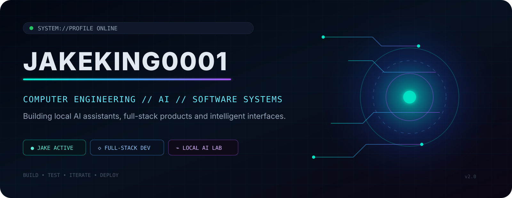
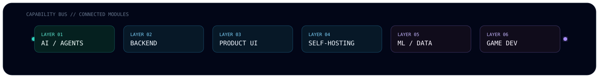
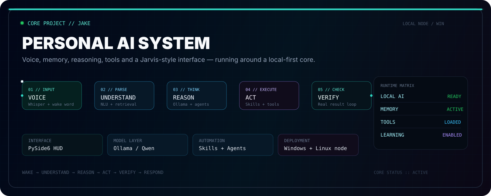
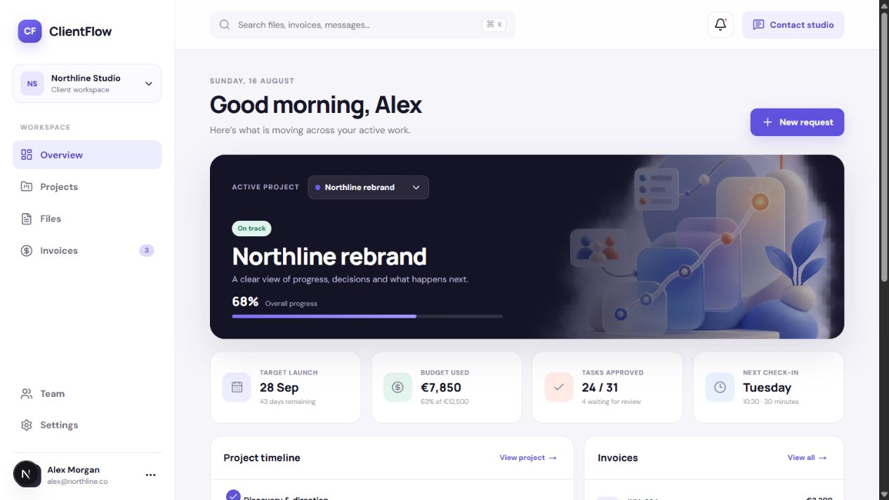
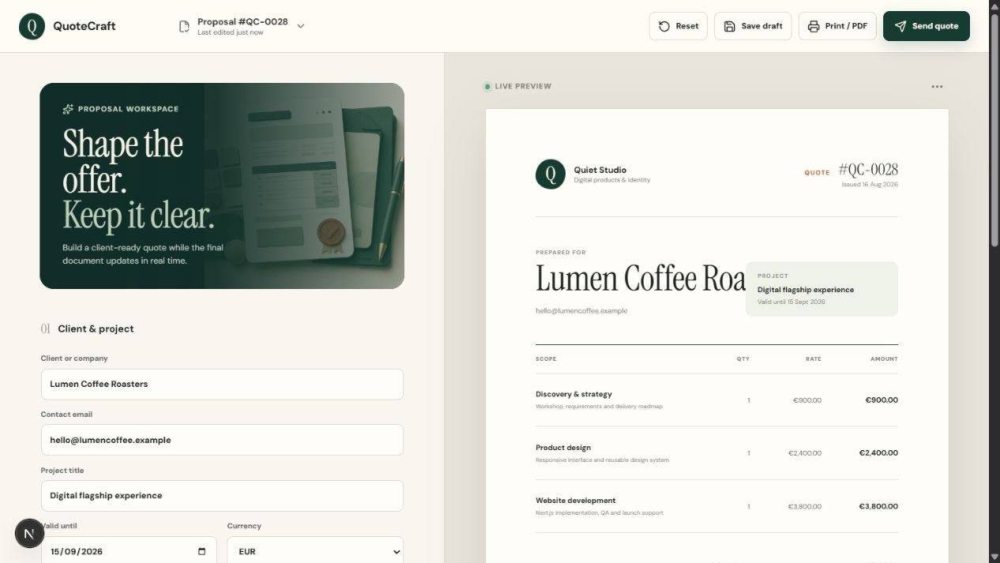
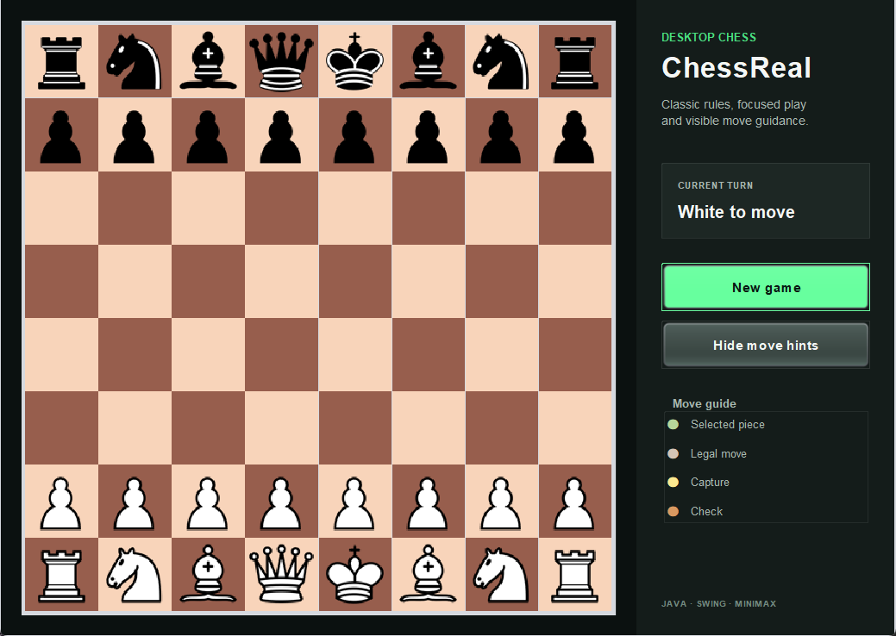

<p align="center">
  
</p>

<p align="center">
  
</p>

<p align="center">
  <a href="https://github.com/JakeKing0001/Jake"></a>
  
  
</p>

<p align="center">
  
</p>

## `01 // IDENTITY`

<table>
<tr>
<td width="54%" valign="top">

```text
$ whoami
Davide

$ role
Computer Engineering Student

$ current_mission
Designing intelligent software systems
with a strong focus on AI, automation,
full-stack products and local-first tools.
```

</td>
<td width="46%" valign="top">

```yaml
profile: JakeKing0001
main_project: Jake
environment: Windows + Linux
specialization: AI / Agents / Full Stack
energy_source: curiosity + obsession
render_style: dark neon futuristic
```

</td>
</tr>
</table>

<p align="center">
  <sub><code>NO GENERIC PORTFOLIO — JUST SYSTEMS, INTERFACES AND BUILDS</code></sub>
</p>

## `02 // JAKE_CORE`

<a href="https://github.com/JakeKing0001/Jake">
  
</a>

<p align="center">
  Jake is my local-first personal AI assistant for Windows: voice interaction, a Jarvis-style HUD, modular skills, memory, multi-step reasoning, desktop control and self-expanding capabilities.
</p>

<p align="center">
  
  
  
  
  
  
</p>

<p align="center">
  <a href="https://github.com/JakeKing0001/Jake"><strong>ENTER THE JAKE REPOSITORY →</strong></a>
</p>

<table>
<tr>
<td width="50%" valign="top">

```text
VOICE LAYER    :: Whisper + wake word
CORE BRAIN     :: Ollama + reasoning
HUD INTERFACE  :: PySide6 glass overlay
MEMORY         :: local storage + recall
AUTOMATION     :: skills + actions + tools
LEARNING LOOP  :: new commands + new abilities
```

</td>
<td width="50%" valign="top">

```text
OBJECTIVE
Build an actual assistant,
not a fake chatbot skin.

RESULT
A system that listens,
reasons, acts and evolves.
```

</td>
</tr>
</table>

## `03 // TECH_MATRIX`

<p align="center">
  
</p>

<p align="center">
  
  
  
  
  
  
</p>

## `04 // PROJECT_GRID`

<table>
<tr>
<td width="50%" valign="top">
  <a href="https://github.com/JakeKing0001/boardverse">
    
  </a>
  <h3>♟ Boardverse // Immersive Chess</h3>
  <p>Full-stack chess platform with 2D/3D play, realtime systems, Stockfish, profiles and protected data flows.</p>
  <p><code>Next.js</code> <code>Three.js</code> <code>Supabase</code> <code>PostgreSQL</code></p>
  <p><a href="https://github.com/JakeKing0001/boardverse"><strong>OPEN PROJECT →</strong></a></p>
</td>
<td width="50%" valign="top">
  <a href="https://github.com/JakeKing0001/clientflow">
    
  </a>
  <h3>◈ ClientFlow // Client Portal</h3>
  <p>Responsive product dashboard for projects, timelines, files, invoices, requests and client activity.</p>
  <p><code>Next.js</code> <code>TypeScript</code> <code>Product UI</code> <code>Vitest</code></p>
  <p><a href="https://github.com/JakeKing0001/clientflow"><strong>OPEN PROJECT →</strong></a></p>
</td>
</tr>
<tr>
<td width="50%" valign="top">
  <a href="https://github.com/JakeKing0001/quotecraft">
    
  </a>
  <h3>◇ QuoteCraft // Proposal Builder</h3>
  <p>Interactive quote builder with editable lines, discounts, VAT, currencies, realtime preview and PDF-ready output.</p>
  <p><code>Next.js</code> <code>React</code> <code>TypeScript</code> <code>Vitest</code></p>
  <p><a href="https://github.com/JakeKing0001/quotecraft"><strong>OPEN PROJECT →</strong></a></p>
</td>
<td width="50%" valign="top">
  <a href="https://github.com/JakeKing0001/ChessReal">
    
  </a>
  <h3>♜ ChessReal // Java Chess</h3>
  <p>Desktop chess application built with Swing, custom move generation and experimental Minimax logic.</p>
  <p><code>Java</code> <code>Swing</code> <code>OOP</code> <code>Minimax</code></p>
  <p><a href="https://github.com/JakeKing0001/ChessReal"><strong>OPEN PROJECT →</strong></a></p>
</td>
</tr>
</table>

<p align="center">
  <a href="https://github.com/JakeKing0001/easybook-starter"></a>
  <a href="https://github.com/JakeKing0001/portfolio-template"></a>
</p>

## `05 // TELEMETRY`

<p align="center">
  
  
</p>

<p align="center">
  
</p>

<p align="center">
  
</p>

## `06 // PROTOCOL`

<table>
<tr>
<td align="center" width="20%"><strong>DEFINE</strong><br /><sub>Turn the idea into a real target</sub></td>
<td align="center" width="20%"><strong>ARCHITECT</strong><br /><sub>Choose the smallest system that can grow</sub></td>
<td align="center" width="20%"><strong>BUILD</strong><br /><sub>Ship in readable, testable increments</sub></td>
<td align="center" width="20%"><strong>VERIFY</strong><br /><sub>Test flows, errors and edge cases</sub></td>
<td align="center" width="20%"><strong>ITERATE</strong><br /><sub>Improve what survives contact with reality</sub></td>
</tr>
</table>

<p align="center">
  <sub><code>PRODUCTION-READY = AUTH + PERMISSIONS + FAILURE STATES + DEPLOYMENT + OBSERVABILITY</code></sub>
</p>

## `07 // SIGNAL_PORT`

<p align="center">
  <a href="https://github.com/JakeKing0001"></a>
  <a href="https://github.com/JakeKing0001/JakeKing0001/issues/new?template=collaboration.yml"></a>
</p>

<p align="center">
  <sub><code>END OF TRANSMISSION // JAKEKING0001</code></sub>
</p>
