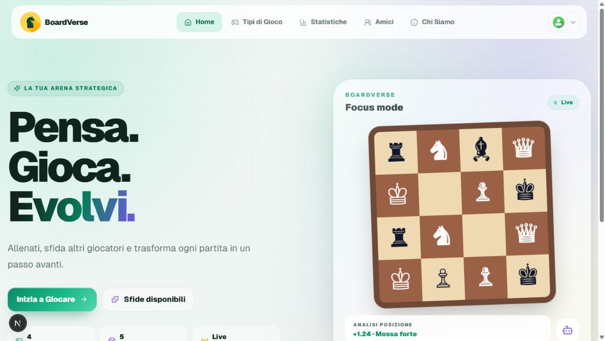

<p align="center">
  
</p>

<h1 align="center">Ciao, sono Davide.</h1>

<p align="center">
  <strong>Full-stack developer e studente di Ingegneria Informatica.</strong><br />
  Progetto interfacce curate e costruisco applicazioni web complete, dal database all'esperienza utente.
</p>

<p align="center">
  
  
</p>

<p align="center">
  
  
  
  
  
  
</p>

## Selected work

<table>
  <tr>
    <td width="50%" valign="top">
      <a href="https://github.com/JakeKing0001/clientflow">
        
      </a>
      <h3>ClientFlow · Client portal</h3>
      <p>Dashboard responsive per freelance e piccoli studi: progetti, timeline, file, fatture, richieste e attività in un'unica esperienza.</p>
      <p><code>Next.js</code> <code>TypeScript</code> <code>Product UI</code> <code>Vitest</code></p>
      <p><a href="https://github.com/JakeKing0001/clientflow"><strong>Esplora ClientFlow →</strong></a></p>
    </td>
    <td width="50%" valign="top">
      <a href="https://github.com/JakeKing0001/quotecraft">
        
      </a>
      <h3>QuoteCraft · Proposal builder</h3>
      <p>Preventivi interattivi con righe modificabili, sconti, IVA, valute, anteprima in tempo reale, salvataggio locale e stampa PDF.</p>
      <p><code>Next.js</code> <code>React</code> <code>TypeScript</code> <code>Vitest</code></p>
      <p><a href="https://github.com/JakeKing0001/quotecraft"><strong>Esplora QuoteCraft →</strong></a></p>
    </td>
  </tr>
  <tr>
    <td width="50%" valign="top">
      <a href="https://github.com/JakeKing0001/boardverse">
        
      </a>
      <h3>Boardverse · Full-stack chess platform</h3>
      <p>Gioco realtime, Stockfish, sfide, profili, amicizie, messaggi e statistiche con Auth, RLS e migrazioni versionate.</p>
      <p><code>Next.js</code> <code>Supabase</code> <code>PostgreSQL</code> <code>Playwright</code></p>
      <p><a href="https://github.com/JakeKing0001/boardverse"><strong>Esplora Boardverse →</strong></a></p>
    </td>
    <td width="50%" valign="top">
      <a href="https://github.com/JakeKing0001/ChessReal">
        
      </a>
      <h3>ChessReal · Java desktop chess</h3>
      <p>Applicazione Swing costruita senza framework scacchistici, con generazione delle mosse, guida visiva e Minimax sperimentale.</p>
      <p><code>Java</code> <code>Swing</code> <code>OOP</code> <code>Minimax</code></p>
      <p><a href="https://github.com/JakeKing0001/ChessReal"><strong>Esplora ChessReal →</strong></a></p>
    </td>
  </tr>
</table>

ClientFlow e QuoteCraft sono demo front-end con dati di esempio, pensate per
mostrare capacità di product design e implementazione senza fingere integrazioni
backend non presenti.

## Altri progetti

- **[EasyBook](https://github.com/JakeKing0001/easybook-starter)** — flusso di prenotazione e area amministratore con Supabase Auth/RLS; limiti di produzione documentati.
- **[Portfolio Template](https://github.com/JakeKing0001/portfolio-template)** — template Next.js responsive e personalizzabile per sviluppatori e studenti.

## Cosa posso costruire

- **MVP e prodotti web completi** — interfaccia, API, database e autenticazione
- **Dashboard e strumenti interni** — flussi chiari, permessi e dati realmente utili
- **Portali cliente e processi commerciali** — preventivi, prenotazioni, documenti e stati di avanzamento
- **Miglioramenti su progetti esistenti** — pulizia, sicurezza, test, performance e documentazione

## Come lavoro

```text
01  Definiamo un risultato concreto e uno scope realistico
02  Costruisco in passaggi piccoli, leggibili e verificabili
03  Testo i flussi importanti e documento la consegna
```

Non considero un prodotto “production-ready” finché autenticazione, permessi,
casi d'errore e deployment non sono stati verificati nell'ambiente reale.

## Parliamone

Sono disponibile per **ruoli junior/full-stack**, collaborazioni e progetti
freelance. Puoi contattarmi tramite i riferimenti pubblici del profilo oppure
[aprire una richiesta di collaborazione](https://github.com/JakeKing0001/JakeKing0001/issues/new?title=Richiesta%20di%20collaborazione).
